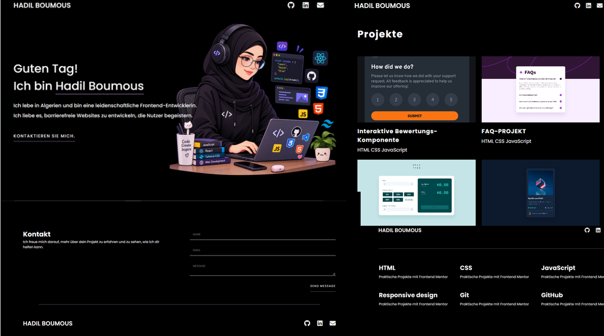

# Mein Portfolio – Hadil Boumous

Willkommen auf meinem GitHub-Repository!

Ich bin Hadil Boumous und interessiere mich leidenschaftlich für die Webentwicklung. Ich beschäftige mich gerne mit HTML, CSS und JavaScript und entwickle responsive und benutzerfreundliche Webseiten.

## Über mich

Ich habe einen Masterabschluss in Informatik und möchte meine Kenntnisse im Bereich der Software- und Webentwicklung durch eine Ausbildung zur Fachinformatikerin für Anwendungsentwicklung in Deutschland weiter vertiefen.

Ich bin motiviert, neue Technologien zu lernen, praktische Erfahrungen zu sammeln und mich fachlich weiterzuentwickeln.

## Technologien und Kenntnisse

- HTML
- CSS
- JavaScript
- Responsive Webdesign
- Git und GitHub

## Meine Projekte

Hier findest du einige meiner praktischen Projekte:

- **FAQ-Projekt** – Eine interaktive FAQ-Seite.
- **Interaktive Bewertungs-App** – Eine Anwendung zur Abgabe von Bewertungen.
- **Trinkgeldrechner** – Eine Anwendung zur Berechnung von Trinkgeld.
- **NFT-Vorschaukarte** – Eine responsive Vorschaukarte.

## Meine Ziele

- Meine Kenntnisse in HTML, CSS und JavaScript vertiefen.
- Meine Fähigkeiten in der Frontend- und Softwareentwicklung verbessern.
- Neue Technologien und Programmiersprachen kennenlernen.
- Praktische Erfahrungen in einem IT-Unternehmen sammeln.

## Kontakt

- **E-Mail:** boumous.hadil@gmail.com
- **GitHub:** [Hadil-BMS](https://github.com/Hadil-BMS)

Vielen Dank für deinen Besuch!

